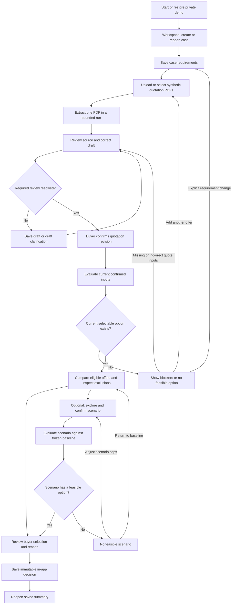

# GreenProcure — user flows and screen plan

**Updated:** 18 October 2026.

**Current status:** the guided quotation-to-saved-selection flow, contextual Google ADK
assistant and workspace refinements are deployed and verified. Assistant PR #14 and UI PR #15
are included in released source `4c4d8b6`. The verification ledger records the exact cloud
release and the fresh hosted rehearsal, completed at 23:22 Vietnam time on 18 October 2026.

**Completed workspace milestone:** desktop navigation/topbar stay visible while content scrolls;
Create and Refresh belong to their respective page/list contexts; Help explains the actual
sourcing steps and recovery controls. Local regression and responsive checks passed, followed
by a hosted flow using real Gemini, human confirmation, comparison, saved selection and a
real assistant answer. Carbon estimates/ranking, scenarios, enterprise/supplier access,
private invitations and component BOM sourcing remain future product scope.

**Next increment, locally verified:** Luma's floating launcher is available across the app.
The Workspace view reads the private saved-case catalog and offers direct/AI-assisted navigation;
Current case preserves precise saved-record help. Luma, Quill and Sage have distinct SVG marks.
Team/context details share the accessible assistant dialog. Screen capture is not used, and
unsaved values are not sent. All existing edit, confirmation and recovery controls remain in
charge. The user approved release from `feat/luma-workspace-assistant` on 19 October;
implementation verification is complete and deployment verification remains pending.

**Original planning baseline:** 14 October 2026, `feat/ui-workspace`, freshly fetched `dev`
at `bb31efe3008f9f8bbad32a7d40bc509bfd870509`.

## 1. Purpose and scope

Give a textile SME buyer one clear path from fabric requirements to an informed sourcing
decision. This document completes the first UI planning task: navigation, screen content,
actions, transitions and recovery states. The linked design package covers visual tokens
and wireframes; implementation proceeds in small reviewed increments.

Minh owns product decisions and review. As of 18 October, Mạnh remains a registered team
member but is unavailable; the user has authorized the coding assistant to implement the
backend, database and Google integration as well as the UI. This does not assign new work
to Mạnh. Commit, release and scope decisions retain the user's agreed review boundaries.

The visual reference is the [BeyondPilot admin](https://beyondpilot.ai/admin) screenshots supplied in the conversation:
light sidebar, white content area, clear page headings, restrained borders, searchable
tables and a prominent primary action. The six [GreenProcure reference images](https://drive.google.com/drive/folders/1PkaGW9hFVnMD_0qD0JuFzMpcUxUJsiSa) inform the
document-review, comparison and scenario layouts. Their sample numbers and limits are
illustrative; repository contracts remain authoritative. Precise styling is task 2.

Sources: [current context](GREENPROCURE_CONTEXT.md), [PRD](GreenProcure_Vietnam_Textile_SME_PRD.md),
[calculation rules](CALCULATION_SPEC.md), [schema](GreenProcure_Vietnam_Textile_SME_Database_Schema.md),
[architecture](ARCHITECTURE.md), and [implementation ledger](IMPLEMENTATION_STATUS.md).
Older Notion/Drive examples do not override these v2 documents.

P0 covers one material line, at most four quotations per case and a private anonymous demo.
It does not add organisation administration, a supplier directory, inventory, purchase
orders, email sending, payments, gamification, risk scoring or PDF export.

## 2. Original planning foundation (14 October 2026)

The table below is historical context from the first UI planning task. Use the current
status above and the implementation ledger for what is implemented and deployed today.

| Capability | Verified in the current source | Planning boundary |
|---|---|---|
| Start/restore a private demo | Anonymous identity and owner-scoped case access | Preserve session isolation and clear prior-owner state on identity change |
| Case list and creation | List/refresh, create, two-case server cap | Reorganise the existing experience before adding new product capabilities |
| Requirements detail | Read-only selected case; six editable creation fields plus fixed preset | Full requirement editing and revision invalidation require new API support |
| Case API | `POST/GET /api/v1/cases`, `GET /api/v1/cases/{case_id}` | Current web client uses list/create; the detail endpoint exists separately |
| Upload, extraction and confirmation | Not implemented | Layouts can be planned; no claim of operational upload or AI |
| Evaluation, scenario, decision and activity | Not implemented | Need backend contracts and persistence before becoming working controls |

Current responses are draft cases at revision 1 with synthetic-demo status and fixed
45/25/30 weights. A screen design must not turn those into fabricated review counts or
completed comparisons. No new tests or live services were run to establish this planning
document; historical foundation verification remains in the ledger.

## 3. Navigation and main flow

Use a compact workspace, with the case as the organising unit:

- **Global navigation:** Workspace and Help & methodology. Workspace is the case list and
  attention queue; a duplicate dashboard/list page is unnecessary for the two-case demo.
- **Case navigation:** Requirements, Quotations, Compare, Decision.
- **Review:** opens within a selected quotation, with previous/next quotation navigation.
- **Scenarios:** opens from Compare and returns to its preserved baseline.
- **Context:** breadcrumb, case name, saved status, and a concise requirement summary remain
  visible. Optional explanation/activity panels are part of the working screen.

These are screen groupings, not a commitment to new URL paths or a routing dependency.
They fit the existing five view families: Start/Case, Quotes, Review, Compare and
Scenario/Decision. A returning visitor resumes the next useful action from persisted state.

Known technical/commercial failures can be confirmed as accurate and then classified as
ineligible; confirmation does not mean the offer passes. Users can add another quote or
explicitly revise requirements instead of repeatedly reviewing an unfixable offer. A
confirmed requirement change creates a new baseline family. Scenarios are optional:
a valid baseline evaluation can go directly to a decision.

### Future general platform agent — separate milestone

**User direction, 16 October 2026:** one general agent is available throughout the platform,
aware of the current screen and workflow, and able to perform relevant authorized actions.
It is not confined to comparison explanations. Implement this on a separate milestone branch;
the scenario branch adds no agent code, launcher or nonfunctional placeholder.

- Keep its entry point available across workspace, requirements, intake, review, comparison,
  scenario and decision views. Present the active case/record scope before acting; changing
  screens does not silently retarget a pending request or carry another case's advice across.
- Pass a bounded context envelope: screen/workflow step, case ID, selected quote ID, evaluation
  and run IDs where applicable, current/saved case and draft/confirmed-quote revisions,
  evaluation fingerprint/freshness, pending operation references and unsaved-change state.
  Unsaved values are explicitly local proposals; never treat them as persisted or confirmed.
  Send only relevant fields, not the entire DOM, private source documents or credentials.
- Use the planned coordinator architecture with Quotation and Sourcing Specialists. Screen context informs
  navigation, record reads, extraction/evaluation requests, explanations, clarification drafts
  and proposed corrections/scenarios. Backend tool allowlists and available capabilities,
  not arbitrary model-generated action names, determine what can actually run.
- Each tool rechecks authenticated identity, owner, record membership, expected revision and
  capability on the server. Browser context is a hint, not authority. Source text remains
  untrusted evidence and cannot grant permissions or change the agent's instructions.
- Show proposed edits with their affected values, evidence/assumptions and consequences for
  existing results. The user reviews before applying them through the appropriate workflow.
  Quote confirmation, scenario confirmation and final decision remain explicit human actions
  through the human-facing guarded routes defined by the architecture; no coordinator/specialist approval tool is added.
- Show actual safe operation events and result references. Preserve pending request identity
  across navigation; stale inputs require refreshed context/review, and unknown write outcomes
  require recorded-state readback before retry. Switching owner clears retained context.
  Availability does not mean continuous background model execution or invented progress.

The first agent milestone needs an agreed context/tool contract, owner and live integration
plan. It must show an authorized action and its recovery end to end, rather than only a chat
panel. This direction does not change the comparison milestone's backend scope.

### First contextual assistant increment - implementation scope

The assistant has one persistent entry in the app shell and a contextual right drawer
(full-screen on a narrow display). It names the active case, workflow step and saved-state
boundary. It preserves the underlying workflow and uses existing navigation guards.
Without a selected case it offers ordinary workflow guidance; it does not pretend that an
AI request has run. Screen changes update bounded local context rather than sending every
keystroke to a model.

The backend uses actual Google ADK coordinator/specialist calls inside the existing service.
The first useful outcomes are saved quotation review guidance, a copyable supplier
clarification draft, explanations of current confirmed cost/delivery checks, and explanations
of an immutable saved buyer selection. Existing deterministic services own facts and amounts.
Allowed action cards open the relevant existing workflow or refresh checks. No tool marks
fields reviewed, confirms quotations, saves a buyer selection, sends messages, or writes
arbitrary data. Extraction remains its existing separate explicit operation.

Each request has an owner-scoped persisted identity, bounded model/tool work, actual activity
events, explicit cancellation and recorded-state recovery. The first transport uses a
bounded POST plus polling of recorded events; that is live activity, not token streaming or
a background-job guarantee. Every nested generation counts against shared AI limits.
Results retain their source revisions; context changes invalidate actions. Saved-record
explanations must not silently incorporate local unsaved edits.

Acceptance works backwards from a buyer asking what blocks progress, inspecting the stated
evidence, opening the correct existing screen, and continuing the normal reviewed workflow.
Checks include another owner's access, changed revisions, prompt injection, forbidden actions,
model-call limits, repeated clicks, cancellation/interruptions, context switching, keyboard
focus, narrow screens and enlarged text. Test inputs and screenshots stay in OS temp.

### Workspace UI increment - deployed and verified

- Keep the desktop sidebar and top navigation stable while the selected content area scrolls.
  Changing tabs changes content and active navigation, with deliberate scroll/focus handling.
  On small screens, use a compact accessible navigation arrangement rather than shrinking
  a permanent desktop column into the working area.
- Make **Create sourcing case** the clear primary page action. Place **Refresh cases** next
  to the saved-case list it updates, with consistent button height, spacing and loading state.
  Audit other headings so broad flex rules do not stretch or misalign their action groups.
- Rename the Help destination to a plain user guide and lead with the actual sequence:
  create requirements, add PDFs, review and confirm, compare, save and reopen a choice.
  Explain where to click, what each step produces, and how to resolve common blockers.
  Keep detailed comparison assumptions and demo limits in secondary expandable sections.
- Verify sidebar position at the top and bottom of long pages, selected navigation, content
  scrolling, mobile/short-height layouts, 200% text, unsaved-navigation protection, and the
  assistant drawer if this increment is later integrated with the assistant branch.

### Product expansion requested - buyer/supplier workspaces and product materials

The user requested two product experiences on 18 October: enterprise staff sourcing materials,
and external suppliers responding to sourcing requests. This is future scope; the current
anonymous private demo does not provide enterprise memberships or supplier access.

Recommended buyer flow: define the finished product/style and order quantity, add its bill of
materials (BOM), select the components to source, publish a request for quotation (RFQ), review
supplier responses per component, compare eligible offers, and record the chosen supplier(s).
Keep direct single-material sourcing available for a buyer who already has the specifications.
The current fabric case can later be one sourcing line beneath a product order.

Recommended supplier flow: authenticate, open an authorized published RFQ, review the shared
component specifications/deadline, quote the lines the supplier can supply, attach supporting
PDFs, submit, and revise through an explicit versioned submission workflow. Internal budgets,
review notes and competing supplier offers are not part of the supplier-visible RFQ. A route or
client role selector is not authorization: server-side organization membership, request access,
file access and quote ownership must enforce each boundary. The user selected private
invitations for the first release; public discovery remains outside this milestone.

A product BOM lists the specified quantity and unit for each component needed for a finished
product, with variant-specific requirements where relevant. This follows the standard BOM
concept described in [Odoo's component/variant documentation](https://www.odoo.com/documentation/20.0/applications/inventory_and_mrp/manufacturing/management/bill_configuration.html).
For the proposed T-shirt example, potential lines include main fabric, neck ribbing, sewing
thread, brand/size/care labels, hangtag and packaging. Interlining, buttons and hangers are
optional requirements of the actual product, not universal defaults. The 65/35 polyester/cotton
blend belongs to the applicable fabric specification; it must not silently describe every
component or the whole finished garment.

Record garment quantity in pieces separately from each component's sourcing quantity and unit
(metres, kilograms, pieces or another supported unit). Per-garment consumption, size/color
breakdown, agreed waste allowance, pack size and MOQ need explicit inputs before deriving a
purchase quantity. Do not invent consumption from garment count or composition. Show net
requirement, allowance and intended purchase quantity separately; extra MOQ purchasing is an
explicit decision and differs from the current single-fabric comparison rules.

Implement in independent milestones after the assistant and workspace refinement: first
organization identity/membership and RFQ visibility, then product/BOM and sourcing lines, then
supplier submission/versioning and line-based comparison. Update the PRD, schema and migration
plan before changing the live owner-scoped business model. This plan does not implement a schema migration, new account role, public listing or supplier notification.

## 4. Screen specifications

### S0 — Entry and sourcing workspace

**Question:** What needs my attention, and where do I continue?

- Before sign-in: concise explanation and **Start private demo**. Explain private session
  access and that clearing browser data can lose access; do not imply an email account exists.
- After restoration: case rows show name, saved lifecycle status, updated time and a next
  action derived from persisted state. Future quote/review counts appear only when available.
- Primary action: **Create sourcing case**; for an existing case, **Continue case** opens the
  relevant saved stage. At the case cap, explain the limit and offer to reopen a case.
- Empty state explains the next step. Loading, unavailable API and identity failures have
  explicit recovery. Do not show an empty list while a request is merely unresolved.
- Saved decisions can be reopened from their case; no separate reporting dashboard is needed.

### S1 — Case requirements

**Question:** What must every acceptable quotation satisfy?

| Field group | Planned content | Current foundation |
|---|---|---|
| Case and order | Name, quantity in metres, visible order reference date | Editable on creation |
| Delivery and budget | Destination, maximum calendar days, amount and currency | Destination, days and USD amount editable; currency fixed to USD |
| Textile | Construction, composition, composition tolerance, target GSM/tolerance, usable width; optional colour/finish/evidence | Fixed woven 65/35 preset, 130 GSM ±5%, minimum 150 cm; no required certificate |
| Comparison basis | Included/excluded cost categories and declared transport/accounting boundary | Fixed preset values; full editing is future work |

- Primary action on creation: **Create case**. After a confirmed save, continue to Quotations
  when that capability exists. Current foundation-only UI continues to saved requirements.
- Expose preset requirements as readable values; do not render unavailable fields as editable.
- Label composition tolerance in percentage points and GSM tolerance in percent. Keep date
  and calendar-day semantics visible; never update a saved order date as the clock changes.
- Future **Save requirement changes** explains that dependent comparisons become outdated.
  Preserve prior evaluations/decisions and require a new evaluation before another decision.
- Validate fields inline and in a linked summary. Failed or uncertain saves retain entered
  values and do not navigate as if saved. Future editing needs revision-aware API support.

### S2 — Quotations

**Question:** Which documents are available, and which need review?

- Empty case: lead with **Upload quotation** or **Use synthetic sample**. Once documents exist,
  show quotations and their next actions first, followed by an expandable **Add a quotation**
  section. Collapsing or reordering preserves the selected file; recovery keeps the form visible.
  Connected samples must use the same private upload/extraction path and remain labelled synthetic.
- Show file name, upload/extraction status, review status, missing-information summary and
  the appropriate action: Review, Check status or Retry. Show the four-quote limit.
- Before upload, explain Google model processing, private storage, configured retention
  and anonymous-session access. Do not invent a retention period; resolve it before release.
- Target digital Vietnamese/English PDFs. Proposed file limits are 10 MiB and 10 pages;
  display the enforced limits once the upload contract is implemented. Explain unsupported,
  encrypted, oversized or unreadable documents. A fifth quote cannot bypass the server limit.
- One PDF per bounded extraction run. Keep other quote records visible during processing.
  No simulated percentage or suggestion of an implemented background queue.
- Each row separates saved PDF, extraction and human-review states. Use one relevant action:
  Extract information, Check status, Retry extraction, Review quotation or View reviewed quotation.
  Review opens only when the review state is ready; failed extraction keeps a useful error and
  explicit retry. It never substitutes fixture results in live mode.
- Keep order, budget and the full delivery requirement visible; disclose longer fabric specs
  on demand. Upload is prominent and Clear selected PDF stays a quieter secondary action.

### S3 — Quotation review and confirmation

**Question:** Is the extracted information accurate, complete enough and traceable?

- Desktop: authorised PDF/page view beside editable fields. Narrow screens use a clear
  Source/Fields switch while retaining the selected field, page and unsaved edits.
- Group fields into textile, price/MOQ/cost basis, delivery, logistics and required evidence.
  Distinguish usable width from total width, and net material mass from shipment mass.
- Each relevant field exposes its source page/excerpt when available, correction/assumption
  provenance and review state. Unavailable evidence says so; no invented source highlight.
- A persistent issue summary names the affected fields and what they block: technical,
  cost, delivery, carbon, evidence or ranking. Noncritical notes do not block valid metrics.
- **Save draft** persists corrections without confirmation. **Draft clarification** produces
  copyable questions about actual gaps. It does not contact a supplier.
- Primary action: **Confirm reviewed quotation**, explicitly performed by the buyer against
  the latest saved draft. Required unresolved review issues direct the buyer to the relevant
  fields; a known reviewed hard failure remains recordable and visible as ineligible.
- After confirmation, show the confirmed revision and **Review next quotation** or
  **Go to comparison**. The latter can show blockers; confirmation does not promise ranking.
- Later corrections create new reviewed state and invalidate dependent results. Keep raw
  extraction and earlier confirmed revisions intact. Warn about unsaved edits before leaving.

### S4 — Supplier comparison

**Question:** Which reviewed offers meet my requirements, and what are the trade-offs?

- Primary action before results: **Evaluate quotations**. Use current confirmed data and a
  user-visible baseline policy. Incomplete/unconfirmed records remain visible as blockers.
- Present suppliers side by side with aligned rows for technical/commercial eligibility,
  comparable cost and basis, end-to-end days/arrival, estimated logistics CO₂e and boundary,
  source limitations, preference score and exclusion reasons.
- Eligible ranked options and incomplete/ineligible offers have distinct labelled groups;
  excluded offers are still inspectable. Missing values display a reason, never a numeric zero.
- Balanced policy is cost 45%, lead time 25%, carbon 30%. The backend supplies ordering,
  scores, winner and authoritative amounts. Scores are relative preferences, not sustainability
  ratings. A singleton is labelled **Only eligible option**.
- Source details expose price inclusions, confirmed inputs, mass/distance provenance and
  factor/boundary limitations without burying the main comparison.
- With a current selectable result: **Review decision**. Secondary action: **Explore scenario**.
  Allow an explicit eligible buyer choice different from the preference winner.
- Keep the main screen compact: case context and current state, a concise comparison-basis
  summary, the aligned offer table and the next decision action. Put detailed methodology,
  source provenance and longer explanations in accessible disclosures or details views.
  Blocking reasons and essential synthetic/stale/unavailable labels remain visible.
- Explanation is optional supporting detail. A known read-only explanation request bound to
  this evaluation may be pending, fail or have an unknown outcome without clearing a valid
  buyer selection or invalidating the matching computed results. Disable duplicate requests
  and recover that explanation operation separately. Evaluation/refresh uncertainty, stale
  inputs and denied capabilities still block advancement.
- Missing approved factors block complete live carbon ranking, even if carbon has zero weight.
- Outdated results remain inspectable as history; **Re-evaluate** is required before saving
  a new current decision. No eligible/feasible option gives reasons and actions, not a winner.

### S5 — Optional scenario exploration

**UI implementation boundary, 16 October 2026:** the current branch implements an independent
synthetic walkthrough with editable draft, explicit review/application and supplied results.
It does not calculate a live result as inputs change. Exact prepared signatures are documented
in README; all other valid policies need the future deterministic preview/evaluation API.
Presentation types must be mapped to generated contracts after Mạnh agrees the proposed handoff.

**Question:** How would another preference or relative limit change this decision?

- Show the frozen baseline winner, input revision and comparison boundaries. Presets:
  Balanced, Lowest Cost, Lower Carbon, Fastest Delivery, Custom. Lower Carbon is 10/10/80.
- Weight edits request a deterministic preview; they do not invoke Gemini on every movement.
  Validate total weight instead of silently normalising it. Label unsaved previews clearly.
- Optional relative caps expose their baseline: maximum cost increase and minimum carbon
  reduction. Undefined percentages remain unavailable with an explanation.
- Natural-language requests produce a structured proposal. The buyer reviews and confirms
  the proposed weights/caps before persistence/evaluation. Ask for an explanation separately.
- Primary action: **Apply scenario** confirms the policy and obtains its current evaluation;
  **Review decision** then opens selection from that saved evaluation. Returning to Compare
  restores the original baseline, which is never overwritten.
- Technical, MOQ, budget and deadline failures remain excluded. Requirement changes use S1
  with explicit confirmation and a new baseline, rather than masquerading as weight changes.
- **No feasible option** is a normal result: adjust a relative cap, return to baseline or
  review requirements. Do not automatically relax requirements to manufacture a winner.

### S6 — Buyer decision and saved summary

**UI implementation boundary, 16 October 2026:** comparison and scenario walkthroughs pass
exact in-memory selections into the shared decision review. The standalone decision preview
supplies independent fixtures. Simulated saving/reopening is temporary; durable storage,
refresh recovery and owner-enforced server acceptance require the proposed backend handoff.

**Question:** What am I choosing, why, and what evidence supports it?

- Show the selected quote, active baseline/scenario, current evaluation, recommendation,
  comparable metrics, assumptions and limitations. Require a buyer selection reason.
- Primary action: **Save decision**. The server must accept the exact current evaluation
  and a selectable eligible/feasible quote; a stale result returns to re-evaluation.
- A buyer choice different from the score winner is labelled as such; do not rewrite the
  original recommendation. Agents cannot confirm the choice.
- After server acknowledgement: **Decision saved**, timestamp and immutable in-app summary.
  Reopen the saved snapshot after refresh. Edits never rewrite this historical decision.
- No purchase order, supplier message or payment occurs. PDF export remains outside P0.
- On an uncertain save, check persisted state before offering another submission; do not
  optimistically claim success or silently create a second decision.

## 5. State and recovery rules shared by all screens

Do not collapse these independent dimensions into one green status badge:

| Dimension | Examples / source | UI meaning |
|---|---|---|
| Case lifecycle | Schema: draft, collecting_quotes, reviewing_quotes, ready, decided, archived | Overall saved stage; only draft is currently implemented |
| Document processing | Uploaded/extracting/failed and recorded run result | Whether extraction produced a draft, not whether it is correct |
| Human review | Unreviewed draft, unresolved review, confirmed revision | Whether the buyer has reviewed the cited input |
| Eligibility | `eligible`, `ineligible`, `needs_review` | Server result with all reasons; known failure outranks missing data |
| Evaluation outcome | `complete`, `incomplete`, `no_feasible_option` | Whether the calculation provides selectable results |
| Freshness | Current, outdated/historical; unsaved local changes | Whether results match the inputs now being considered |

UI wording is a presentation proposal, not an additional API enum. Scenario feasibility is
also checked within the active evaluation; a baseline-eligible quote can fail scenario caps.

| State | Required feedback | Recovery |
|---|---|---|
| First use / empty | Explain what is missing; no fabricated counts or results | Create case or add PDF |
| Loading / running | Actual request/run state; disable duplicate submission | Inspect existing data; cancel only if the API supports it |
| Invalid input / missing evidence | Field-level issue and blocked capability | Correct, record a reviewed assumption, or draft clarification |
| Extraction failure / malformed response | Failure reason; no silent fixture fallback | Explicit retry when permitted, or provide a readable PDF |
| Disconnect / timeout / uncertain write | Outcome unknown or interrupted; no background-completion promise | Read persisted status/results before an explicit retry |
| Stale revision / conflict | Identify changed inputs; retain local edits for comparison | Reload current state, reconcile and explicitly resubmit |
| Expired session / app verification failure | Explain recovery without exposing another visitor's data | Restore verification; clear prior-owner state on identity change |
| Quota / active-run limit | Enforced remaining allowance and reason when available | Open existing case/run or retry at a server-provided time |
| Missing approved factors | Carbon/ranking unavailable; preserve other valid diagnostics | Explain the reference dependency; never infer factors |
| No feasible option | Show each blocking constraint | Adjust the scenario or explicitly revise requirements |
| Explanation unavailable | Preserve deterministic table and source references | Retry explanation separately when permitted |
| Saved / historical decision | Clear save acknowledgement or historical label | Reopen the snapshot; create a new evaluated decision for changes |

Activity panels show safe, actual run/tool events and result references. They do not expose
private model reasoning, fake progress, raw credentials or full supplier documents. An
explicit retry after an ambiguous provider failure may consume allowance; do not promise
exactly-once model billing. Local unsaved changes must not leave a decision action enabled
against results that appear to describe those changes.

## 6. Interaction and accessibility requirements for later wireframes

- One clear primary action per screen/state; explain a disabled action beside the control.
- Keep the case context visible across steps. Back navigation preserves saved state and
  offers a clear choice for unsaved edits; it does not imply a successful save.
- Use text labels and icons with status colours, visible keyboard focus and labelled fields.
  Validation summaries link to affected inputs. Dynamic status/error messages are announced.
- On narrow screens, stack forms, provide an accessible document/fields switch, and contain
  wide comparison-table scrolling within a labelled region with persistent row labels.
- Progress indicators reflect saved steps; no XP, leaderboard or rewards for accepting AI advice.
- Do not surface nonfunctional future controls in the first working UI increment. Design-only
  prototypes must be explicitly identified as prototypes if later created.

## 7. Frontend/backend handoff and unresolved contracts

| UI area | Data/action needed | Dependency |
|---|---|---|
| Workspace/requirements today | List/create/read own cases; typed validation and quota errors | Existing OpenAPI |
| Requirements editing | Expected revision, validation, new revision and stale dependencies | Planned PATCH route; model/response not implemented |
| Quote collection | List quote records, upload, synthetic sample selection and limit metadata | Upload is designed; quote listing/sample-loader response needs agreement |
| Review | Draft, provenance, issues, private document, save draft, explicit confirmation | Planned routes; exact generated types pending |
| Comparison | Confirmed input refs, baseline policy, immutable results and freshness | Planned evaluations/scenarios; no current calculation API |
| Scenarios | Deterministic preview, human confirmation and saved evaluation refs | Preview service is designed; public preview contract needs agreement |
| Decision | Eligible selection, reason, exact evaluation ref, save/read summary | Planned decision routes; uncertain-save/idempotency readback needs agreement |
| Recovery/activity | Actual run status/events, allowance and retryability | Planned run routes; quota-read/cancel contract not settled |
| Future general platform agent | Screen/workflow/record/revision context, unsaved proposals and authorized action capabilities | Separate milestone; coordinator/specialist tools and context contract require agreement |

Pydantic/OpenAPI remains the API authority; generate TypeScript rather than hand-writing
another schema. JSON stays `snake_case`; monetary and physical values retain decimal-string
precision. The UI formats server results and never independently chooses an authoritative
winner. Firebase identity/App Check and all owner/state guards remain server-enforced;
browser code does not access Firestore/Storage directly.

Open questions are bounded implementation handoffs, not reasons to stop designing:

1. Agree draft-save/confirmation behaviour and field completeness rules, including how a
   reviewed hard failure is retained without suggesting eligibility.
2. Define missing collection/sample/preview/status responses and stale/error shapes before
   connecting their screens. Determine reliable readback after ambiguous mutations.
3. Confirm the enforced PDF/run quotas and retention notice before public upload is enabled.
4. Assign backend/domain, AI integration and release work explicitly with Mạnh.

## 8. Planning acceptance and next work

Walk through these scenarios when reviewing wireframes. These are design acceptance cases,
not claims of executed application tests:

- New and returning anonymous visitors reach the right private case without an organisation
  setup step. The two-case cap has a useful recovery path.
- A quote with missing transport mode stays unresolved; saving a draft does not confirm it.
  The buyer can inspect evidence, draft a clarification and explicitly confirm a correction.
- A current Balanced evaluation ranks A over B; Lower Carbon can favour B while C remains
  late and D remains technically unsuitable. Use [the calculation fixture](CALCULATION_SPEC.md)
  for internally consistent examples; its carbon coefficient is test-only, never a live factor.
- Zero eligible options, one eligible option, unknown emissions and incompatible cost bases
  each have an honest, actionable presentation. Zero weight does not bypass metric completeness.
- The buyer saves directly from the baseline or after an optional scenario, with a reason.
  An eligible alternative choice remains distinct from the engine recommendation.
- A quote edit invalidates the comparison; a saved historical decision remains unchanged.
- Refresh, identity change, lost connection, failed extraction, failed explanation and an
  uncertain save all preserve the distinction between known results and unresolved work.

**Design follow-up:** the [offline wireframes](design/UI_WIREFRAMES.html) and
[visual-direction guide](design/VISUAL_DIRECTION.md) now cover the seven screens,
representative recovery states, responsive layouts and proposed styling.

**Milestone 1 implementation:** the shared layout and existing case list/create/detail
experience in `apps/web` have been refreshed, including a help view, validation, unsaved-draft
protection and uncertain-save readback. In-app navigation preserves the existing anonymous
session and case APIs; direct case URLs, saved-requirement editing and later sourcing steps
remain unavailable. See [the verification ledger](IMPLEMENTATION_STATUS.md).

**Workspace refinement:** the create form now groups fixed specifications into a compact,
visible summary and expands detailed methodology on demand. Budget and delivery semantics,
fabric tolerances and the logistics boundary remain visible. Entry and saved-case copy
distinguish the intended sourcing outcome from today's create/save/reopen functionality.
See the implementation ledger for verification and remaining limitations.

## 9. Delivery gates, branch isolation and backward review

Our UI Milestone 1 is the requirements-workspace foundation, not completion of PRD I1.
The next product gate is one real PDF through extraction, source review, correction,
human confirmation and deterministic evaluation. Small branches contribute to that shared
acceptance gate; a finished screen alone does not demonstrate the connected product.

| Reviewable task / proposed branch | Outcome and dependency |
|---|---|
| `feat/ui-workspace` (merged to `dev`) | Requirements flow and its refinements reviewed and integrated |
| `feat/ui-quotation-intake` (integrated into `dev`) | User-approved scope: reusable intake UI, development simulation and concrete API handoff; no backend implementation |
| Later intake integration, separate branch | Connect real upload/sample path and persisted processing state after collection/upload/run contracts and backend are ready |
| `feat/ui-quotation-review` (merged to `dev`) | UI plus proposed API handoff: synthetic source inspection, corrections, separate draft save/confirmation, and recovery; no backend or live extraction |
| Later review integration, separate branch | Connect authorized source access, versioned draft saves and human-only confirmation after the backend contract is agreed |
| `feat/ui-first-evaluation` | Connect the reviewed quotation to authoritative results; prove PRD I1 end to end |
| `feat/ui-input-revisions` | Saved-requirement editing, conflicts and stale-result handling with revision-aware API support |
| Merged `feat/ui-quote-comparison` | UI plus proposed API handoff: independent synthetic comparison, A/B trade-off, C/D exclusions, missing/stale/recovery states and local choice handoff; connected I2/I3 remain pending |
| Merged `feat/ui-scenarios` | UI plus proposed [API handoff](SCENARIO_CONTRACT.md): exact priorities, reviewed application, preserved baseline, supplied trade-offs, no-feasible and saved-confirmation recovery; backend preview/evaluation remain pending |
| Current `feat/ui-decision-summary` | UI plus proposed [API handoff](DECISION_CONTRACT.md): exact human choice/reason, simulated immutable save/reopen and stale/unknown-save guards; connected I3 remains pending |
| Future `feat/ui-platform-agent` | General agent available across screens, contextual authorized actions and human-reviewed proposals; separate context/tool contract and backend dependency, not part of comparison |
| `test/ui-demo-readiness` | Full acceptance journey and failure/accessibility checks; distinguish local evidence from I4 deployed evidence |

Use C:\AIBuilderCup-MMSquared as the single working folder, per the user's 15 October 2026
instruction. Separate milestones by branch within that checkout; do not create extra
worktrees or duplicate project folders unless explicitly requested. Work on one branch at
a time and preserve current changes before switching. Helpers can work on explicitly owned
files in the active branch without changing Git state. Dependent tasks start from an approved
committed baseline, preferably integrated into `dev`. Do not silently commit, stash or copy
uncommitted foundations into several branches. Backend work has its own branch and agreed
owner; this plan does not assign work to Mạnh without agreement.

**New-branch publication rule, 15 October 2026:** before a new milestone, preserve any current
changes, switch to dev and run `git pull --ff-only origin dev`. Create the milestone branch
from that updated dev, then immediately `git push -u origin <new-branch>`. The user has given
standing authorisation for this initial branch push. Verify its remote baseline before building.
The branch is visible remotely at once; a PR needs new commits relative to dev. Later feature
commits, pushes and merges retain their respective approval boundaries.

**Intake UI review, 15 October 2026:** `quotation-preview.html` is a separate development
entry. It covers file preflight, sample selection, distinct upload/extraction/review states,
uncertain-result recovery, and the case cap. All outcomes are synthetic and memory-only;
the real case workspace has no link to this preview. Requirements use the supported woven
fabric preset. At the quote cap, the upload form is hidden while retaining pending selection, so review actions are
easier to reach. The [proposed API handoff](QUOTATION_INTAKE_CONTRACT.md) records outstanding
backend requirements. This task does not complete FR-03 or PRD I1.

**Review UI scope, 15 October 2026:** the intake Review action opens a separate synthetic
review workspace. Source evidence belongs to its labelled demonstration PDF; it is never
passed off as extracted from an uploaded file. Preserve immutable original values, reviewed
corrections, missing-information blockers and separate saved/confirmed revisions. Follow the
[proposed review handoff](QUOTATION_REVIEW_CONTRACT.md) before connecting backend actions.
Local UI behavior does not complete FR-04/FR-05/FR-06 or I1.

Before handing over every development task:

1. Identify the buyer outcome and exact PRD acceptance requirement.
2. Work backwards through the preceding actions, saved inputs, evidence, state and API guarantees.
3. Exercise relevant happy, missing-data, failure, interruption, refresh and stale-state paths.
4. Inspect changed desktop/mobile layouts, keyboard navigation and next-action clarity.
5. Refine gaps within the task and rerun affected checks. Broader changes get a separate task/branch.
6. Record executed checks, live/fixture/unavailable paths, dependencies and user review steps.

Leave all implementation changes uncommitted until the user explicitly requests a commit;
push, merge and deployment require their respective authorization. Review is not automatic
permission to commit. Later wireframes remain design examples until their API paths work.

When a commit is requested, split the branch's changes into coherent commits by functionality
or section. Write meaningful messages explaining what changed and why, without being unnecessarily
long. Use mostly non-technical language with a little technical detail where useful. Stage reviewed
files explicitly and keep private test cases and artifacts local. Commit-only approval stays local;
a request covering both commit and push authorises both without another confirmation.
This standing preference is also recorded in `AGENTS.md`.
