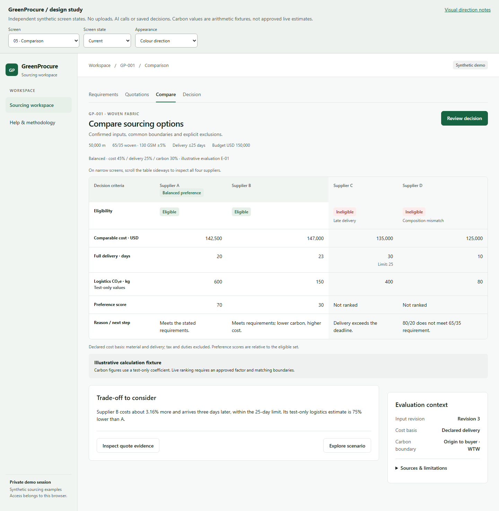
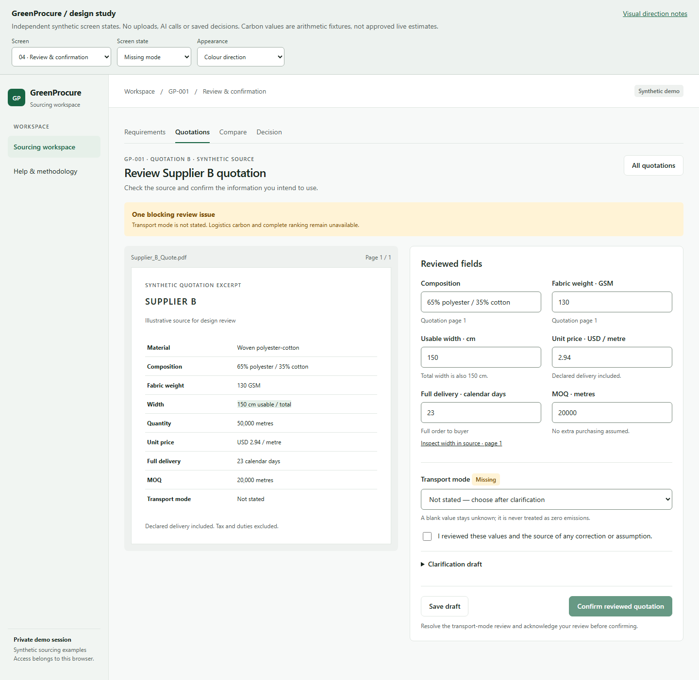

# GreenProcure — visual direction and wireframe guide

**Date:** initial direction 14 October 2026; implementation rules updated 15 October 2026
**Status:** original wireframe reference plus current implementation consistency rules
**Original planning branch:** `feat/ui-workspace`

## Purpose and references

Use the [screen and user-flow plan](../UI_UX_PLAN.md) as the interaction authority.
The supplied BeyondPilot admin screenshots inform the pale sidebar, light workspace,
clear headings, thin borders and readable tables. GreenProcure uses forest-green actions.
The supplied GreenProcure references inform document review, comparison and scenarios;
their sample claims, numbers and limits do not override repository v2 requirements.
This direction proposes presentation choices; it introduces no new product capability.

Open [UI_WIREFRAMES.html](UI_WIREFRAMES.html) directly in a browser, offline.
The sibling HTML is a review-only clickable mock with independent synthetic screen
snapshots. Navigation selects a snapshot; selected decision choices can carry between local preview frames, but no real case is persisted.
Its wireframe/colour toggle compares neutral structure with the proposed palette.
It has no backend, authentication, model calls, real uploads or saved business records.
Keep its prototype label visible; sample activity and outcomes are illustrations. The table below also specifies future states that are not all drawn in this first wireframe set.

## Visual character and layout

- Use a quiet, practical sourcing workspace with one primary action per screen/state.
- Keep a pale global sidebar and white work surfaces on a lightly tinted canvas.
- Keep global navigation small: Workspace and Help & methodology.
- Within a case, use Requirements, Quotations, Compare and Decision; review belongs to a
  quotation, and optional scenarios open from Compare. Preserve the case breadcrumb.
- Prefer useful lists and comparison rows to decorative metric cards or sparklines.
- Use restrained corners and borders; reserve shadows for overlays and menus.
- Progress reflects saved work, never XP, a sustainability trophy or acceptance of AI advice.

## Current implementation consistency rules

The 15 October 2026 refinement applies these rules to the case workspace, create/detail/help
views, quotation intake and quotation review. The offline wireframes remain historical design
examples; they are not the current implementation or evidence of connected quotation services.

- Shared definitions live in `apps/web/src/styles.css`: body/field text 14px, supporting
  text 13px, metadata 12px at the default 15px root size; section labels use the shared
  section token. Feature styles consume the same tokens.
- Use spacing steps of 4, 8, 12, 16, 20, 24 and 32px. Content panels use 24px desktop
  padding and 16px on narrow screens. Page headings align with the main content gutter.
- Controls use 6px corners, panels 8px and dialogs 12px. Standard actions use 14px text,
  weight 600 and a 44px minimum height; do not override shared button typography with
  feature-wide font resets. Dialogs share a backdrop color and visible focus treatment.
- Status labels retain words as well as color: neutral for unavailable/not-ready states,
  blue for information/processing, amber for attention or uncertain outcomes, red for known
  errors, green for a completed operation. Extraction success does not mean human review
  or eligibility. Those remain separate states.
- Desktop quotation rows share semantic Document, Processing, Review and Action columns.
  Action widths and alignment do not depend on row copy. On narrower content widths they
  become labelled records; filenames and actual failure reasons remain readable.
- Put routine instructions at section level; keep actual missing fields, failed operations
  and recovery guidance near their controls. A new unreviewed field is not a validation error.
  Removing repeated guidance must not remove confirmation gates or source limitations.
- Large text must trigger useful wrapping rather than clipping or forced word fragments.
  Test long names, navigation, header actions, units, dialogs and buttons separately from
  document-level overflow. Put units beside field labels rather than over input values.
- Inspect desktop/mobile screenshots and check exact alignments after functional regression.
  Keep private screenshots, executable tests and detailed reports outside committed files.

## Proposed colour tokens

| Token | Value | Intended use |
|---|---|---|
| Canvas | `#F7F9F8` | Overall workspace background |
| Sidebar | `#F1F5F2` | Global navigation surface |
| Surface | `#FFFFFF` | Forms, tables and document panels |
| Border | `#DFE6E1` | Decorative separators and panel outlines |
| Input border | `#758579` | Distinguishable input/select boundary on white |
| Text | `#18251E` | Headings, labels and primary content |
| Secondary text | `#536259` | Explanatory copy and metadata |
| Primary | `#176443` | Main action, selected navigation text and focus outline |
| Primary hover | `#125035` | Hover treatment for the main action |
| Selected surface | `#E6F0E9` | Active navigation and restrained selection fill |

Use white text on solid primary buttons. Thin decorative borders must not be the only
way to identify interactive controls; provide clear labels and sufficiently distinct
control boundaries. Show a visible focus outline with an offset from the component.
Do not communicate eligibility, required review or historical status through colour alone.

### Text and status pairings

Ratios below were calculated from these hex colours using sRGB relative luminance and
`(lighter + 0.05) / (darker + 0.05)`, rounded to two decimals. Each listed pair exceeds
4.5:1 for normal text. These are colour calculations, not a completed UI accessibility test.

| Pair / status | Foreground | Background | Contrast |
|---|---|---|---:|
| Primary text | `#18251E` | `#FFFFFF` | 15.88:1 |
| Secondary text | `#536259` | `#FFFFFF` | 6.44:1 |
| Secondary text on canvas | `#536259` | `#F7F9F8` | 6.09:1 |
| Primary button | `#FFFFFF` | `#176443` | 7.14:1 |
| Primary button hover | `#FFFFFF` | `#125035` | 9.44:1 |
| Selected navigation | `#176443` | `#E6F0E9` | 6.12:1 |
| Needs review | `#7A4B00` | `#FFF3D6` | 6.72:1 |
| Failed / ineligible | `#9C2D2D` | `#FCEDEC` | 6.53:1 |
| Historical / neutral | `#526157` | `#EDF0EE` | 5.71:1 |
| Informational / processing | `#245B87` | `#ECF3FA` | 6.42:1 |

Pair each status with a short label and, when helpful, an icon. Green may identify a
confirmed save or eligible state; it must never suggest verified environmental performance.
Processing, human review, eligibility and result freshness remain separate dimensions.

## Typography, spacing and responsive behaviour

- Use the existing system sans stack; no external font or additional package is required.
- Start with 14–16px body/table text, 14px labels, 18px section titles and 24px page titles.
- Use approximately 1.5 line height for explanatory text and tabular figures for metrics.
- Right-align numeric table cells; keep units and comparison bases visible.
- Use spacing steps of 8, 12, 16, 24 and 32px; 24px desktop content padding is the default.
- Use 8px corner radii, 1px separators and roughly 44px interactive targets where practical.
- Above 1150px, use a 224px sidebar, 32px page padding and adjacent source/fields panels.
- At 681–1150px, use a 192px sidebar and 24px page padding; below 900px, switch source/fields views.
- At 680px and below, use a compact top navigation row, 16px page padding and stacked forms.
- Preserve the selected field, document position and unsaved changes when switching panels.
- Keep wide comparisons in a labelled scroll region with persistent row labels; do not
  compress all suppliers into unreadable columns. Breakpoints are proposals to validate.
- On mobile, case rows become stacked records with their next action visible; comparison
  tables retain horizontal scrolling and a visible scrolling hint.

## Rendered previews

The offline HTML defaults to grayscale wireframes. Choose **Colour direction** to inspect
the proposed palette. **Screen** and **Screen state** explore the seven views and 23
illustrative states. The snapshots below show the desktop comparison and quotation review.

The standalone artifact was checked at widths of 1440, 390 and 320px: all 23 states fit
without page-level horizontal overflow, with no JavaScript errors or outgoing network
requests. Local interactions checked confirmation gates, failed extraction recovery,
scenario feasibility and pending edits, preserved buyer/scenario selection, stale decision
blocking and the mobile Source/Fields switch. Desktop screens and representative mobile
screens were visually inspected. These checks cover the design artifact, not application
integration or a full accessibility audit; the wider future-state list below remains a
wireframing/implementation checklist.

## Seven screen snapshots

| Screen | Wireframe composition | Required states and interactions |
|---|---|---|
| S0 — Workspace | Page title/action, concise session notice and case list with next actions | Empty, loading, current cases, two-case limit and recoverable identity/API failure |
| S1 — Requirements | Grouped order, budget/delivery, textile and comparison-basis fields | Creation, saved read-only detail, inline errors and future revision-aware editing |
| S2 — Quotations | Upload/sample action, four-quote allowance and document rows | Upload/extraction running, failed/unreadable input, retry, review needed and confirmed |
| S3 — Review | PDF/page pane beside grouped fields, issue summary and confirmation footer | Missing transport mode, unavailable evidence, saved draft, explicit human confirmation |
| S4 — Compare | Aligned supplier columns, labelled eligibility groups and expandable source detail | Current A/B ranking, C/D exclusions, missing metric, singleton, no option and outdated result |
| S5 — Scenarios | Frozen baseline summary, presets/weights/caps, preview and apply action | Unsaved preview, confirmed scenario, invalid weights, undefined percentage and no feasible option |
| S6 — Decision | Chosen offer and policy, reason field, evidence/limitations and saved summary | Current eligible choice, stale blocked save, uncertain save, saved and historical decisions |

Snapshots are design examples, not evidence that any planned state is implemented.
The first three views must distinguish existing case/list/create/read behaviour from
planned upload, extraction and revision editing. Future controls do not belong in the
first working application increment until their behaviour and contracts exist.

## Components and interaction details

- Tables use consistent alignment, readable headers and explicit unavailable-value labels.
- A score is a relative preference, not extraction accuracy or a sustainability rating.
- Review fields expose their source page/excerpt and distinguish corrections from assumptions.
- Save draft and Confirm reviewed quotation are separate actions; agents cannot confirm.
- A confirmed hard failure stays visible as ineligible. Missing information remains distinct.
- Explain disabled decision actions beside the button and link to the relevant blocking issue.
- Scenario controls preserve baseline context; weight movement does not imply a Gemini call.
- The buyer may save directly from baseline or explore a scenario first.
- Source edits make dependent results outdated; prior confirmed revisions and decisions remain.
- If an explanation fails, keep valid calculations visible and offer a separate recovery action.
- Announce dynamic errors/status, support keyboard navigation and link validation to fields.
- Do not fabricate source highlights, progress percentages, activity logs or successful saves.

## Review and implementation handoff

Review the five critical state groups: processing failure; review and confirmation;
eligible/excluded comparison; scenario with no feasible result; outdated versus saved history.
Use the calculation specification's A/B/C/D fixture for consistent synthetic examples.
Its emission coefficient is test-only; a mock must not imply approved live freight factors.

Open contracts remain draft save/confirmation completeness, collection/sample responses,
scenario preview, run/allowance status, stale errors and readback after uncertain mutations.
The enforced PDF/run limits and actual retention policy must be settled before public upload.
Pydantic/OpenAPI remains authoritative; preserve snake_case JSON and decimal-string values.
The eventual UI displays backend calculations; it does not independently determine winners.
Identity, ownership, revision guards and human gates remain server-enforced.
Coordinate backend/domain, AI integration and release ownership explicitly with Mạnh;
these design documents do not assign his availability or unagreed implementation work.

**Next minimal application increment:** refresh the shared layout and existing private
case list/create/detail experience in `apps/web`, retaining the working API and isolation.
Keep upload/review/comparison/scenario/decision implementation for subsequent agreed increments.
No application files, dependencies, deployments or live services are changed by this design draft.
